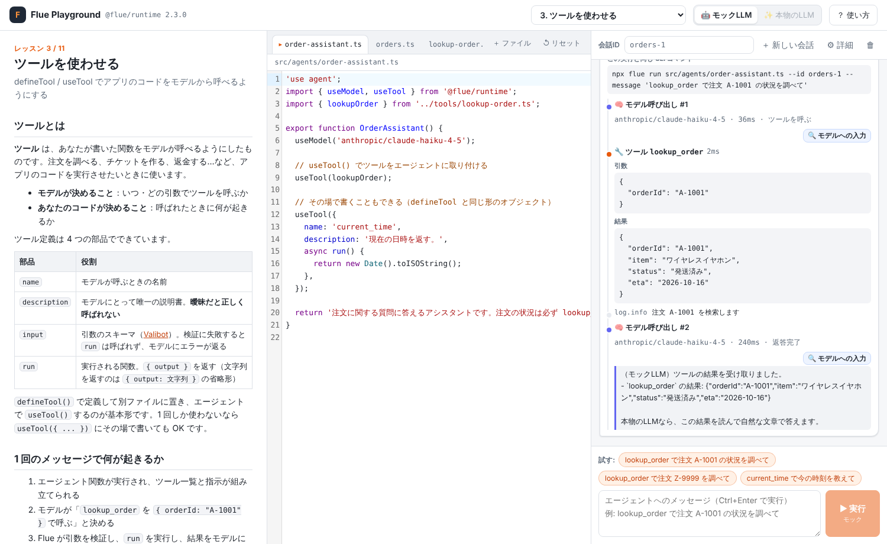

# Flue Playground — 動かしながら学ぶ Flue

[Flue](https://flueframework.com/)（Astro チームによる TypeScript の AI エージェントフレームワーク）を、**ブラウザでコードを書き換えて実行しながら** 学べる Web アプリです。



- 📖 **11 のレッスン**（日本語）：エージェント関数から、ツール・状態・サンドボックス・スキル・サブエージェント・HTTP 公開まで
- ✏️ **エディタ**：レッスンのコードをその場で書き換え（変更はブラウザに保存、↺ でいつでも元に戻せる）
- ▶ **本物の Flue ランタイムで実行**：`@flue/runtime` 2.3 があなたのコードをそのまま動かします
- 🔍 **中身が見える**：モデル呼び出し・ツール実行・サブエージェントへの委任をタイムラインで表示。LLM に実際に送られたシステムプロンプト・ツール一覧・会話履歴も確認できます
- 🤖 **API キー不要**：キーが無くても「モックLLM」で全レッスンを実行できます。キーがあれば本物の LLM に切り替え可能

## 動かし方

Node.js **22.19 以上** が必要です（Flue の要件）。

```bash
npm install
npm run dev
```

ブラウザで <http://127.0.0.1:4321/> を開いてください。

| コマンド | 内容 |
| --- | --- |
| `npm run dev` | 開発モード（UI の変更が即反映される） |
| `npm start` | UI をビルドしてから起動 |
| `npm test` | 全レッスンのサンプルメッセージをモックLLMで実際に実行して検証 |
| `npm run check` | アプリとレッスンのコードを TypeScript で型チェック |

### 本物の LLM で動かす

`.env.example` を `.env` にコピーして API キーを書き、サーバーを再起動すると、ヘッダーで **✨ 本物のLLM** を選べるようになります。

```bash
cp .env.example .env
# .env に ANTHROPIC_API_KEY="sk-ant-..." を書く
```

レッスンのコードは `useModel('anthropic/claude-haiku-4-5')` を使っています。ほかのプロバイダーを使う場合は、エディタで `useModel()` の文字列を書き換え、対応するキー（`OPENAI_API_KEY` など）を設定してください。

## 公開版（Cloudflare Workers）

UI は Cloudflare Workers でも公開しています（URL はデプロイ後にここへ追記します）。

- 公開版では **コードの実行はできません**。実行には Node.js のサーバー（子プロセス・Vite・SQLite）が必要で、Workers では動かないためです
- レッスンを読む・コードを編集する・🔍 で中身を見る、はできます
- 「試す:」のサンプルメッセージを **元のコードのまま** 送ると、CI がモックLLMで実際に実行して記録した結果を再生します
- コードを書き換えて実行したいときは、上の手順で手元に起動してください

デプロイは GitHub Actions（`.github/workflows/deploy.yml`）が行います。

1. PR と push のたびに、型チェック → 全レッスンの実行テスト（結果を `web/public/recordings/` に記録）→ UI のビルド
2. `main` への push のときだけ、ビルド結果を `wrangler deploy` で公開（`/api/*` は `worker/index.ts` が「公開版です」と応答する）

必要な GitHub の Secret は `CLOUDFLARE_API_TOKEN`（「Edit Cloudflare Workers」テンプレートで作ったトークン）と `CLOUDFLARE_ACCOUNT_ID` です。手元で公開版を試すには `npm test -- --record web/public/recordings && npm run build && npx wrangler dev` を実行します。

## モックLLM のルール

モックLLM は、本物の LLM の代わりに決まったルールで応答する偽物のモデルです（Pi の faux provider を使用）。文章は賢くありませんが、フックの実行・ツール呼び出し・会話の保存など **Flue 側の動きはすべて本物** です。

- メッセージに **ツール名** があれば、そのツールを呼ぶ（引数はスキーマとメッセージから推測）
- `$ ls -la` のように `$` で始まる行は `bash` ツールで実行する
- **スキル名・サブエージェント名** があれば `activate_skill`・`task` を呼ぶ
- `/call ツール名 {"引数": "値"}` で任意のツールを明示的に呼べる
- 構造化出力が必要なとき（`finish` ツール）はスキーマに合う値を返す
- それ以外は「受け取った指示・使えるツール・会話履歴」を説明する文章で返事をする

## レッスン一覧

1. はじめてのエージェント — `'use agent'`・エージェント関数・`useModel`
2. 会話IDと再レンダー — 会話の永続化、毎ターン再実行される関数
3. ツールを使わせる — `defineTool` / `useTool`、エラーの扱い
4. 永続ステートと条件付きツール — `usePersistentState`、状態でツールを出し分け
5. サンドボックスで作業させる — `useSandbox` + just-bash の仮想サンドボックス
6. スキルで専門知識を渡す — `SKILL.md` / `defineSkill` / `useSkill`
7. サブエージェントに任せる — `useSubagent` と `task` ツール
8. 初期データとイベントフック — `useInitialData`・`useAgentStart`・`useResponseStart/Finish`
9. 構造化データを扱う — ハーネスツール、`result` スキーマ、`useDataWriter`
10. HTTP で公開する — `app.ts` と `createAgentRouter`
11. プレイグラウンド（総まとめ）

## しくみ

```
ブラウザ（React + CodeMirror）
   │ POST /api/run（コード・メッセージ・会話ID）
   ▼
server/index.ts ── ワークスペース（.playground/workspaces/<クライアント>/<レッスン>/）にコードを書き出す
   │ 子プロセスを起動
   ▼
server/runner/run-agent.ts
   1. Vite（SSR・ポート無し）でエージェントモジュールを読み込む（`flue run` と同じ方式）
   2. start() で Flue ランタイムを起動（会話はワークスペースの SQLite に保存）
   3. init(Agent, { id }).dispatch(message) → read() で返答を待つ
   4. observe() で turn_request / tool_start / task_start などのイベントを購読し、NDJSON で返す
```

- 実行ごとに子プロセスを使うので、プロバイダー登録などのモジュール状態が混ざらず、時間切れ（既定 120 秒）や停止ボタンで確実に止められます
- モックモードでは `start({ providers })` に、Flue の全組み込みプロバイダー ID を模した faux provider を渡しています。そのためレッスンのコードは本物と同じ `anthropic/claude-haiku-4-5` のままで動きます
- 会話は SQLite に保存されるので、同じ会話IDで送ると前の続きになります（🗑 ボタンで削除）

```
lessons/<番号-名前>/lesson.md   … レッスン本文（frontmatter に実行設定とサンプルメッセージ）
lessons/<番号-名前>/files/      … エディタに表示される Flue のコード
server/                         … API サーバーとランナー、モックLLM
web/                            … フロントエンド
worker/                         … 公開版（Cloudflare Workers）の /api/* を処理する Worker
wrangler.jsonc                  … Cloudflare Workers の設定
scripts/test-lessons.ts         … 全レッスンの自動実行テスト
```

レッスンを追加するときは `lessons/` にディレクトリを作り、`npm run check` と `npm test`（`scripts/test-lessons.ts` の `EXPECTED_TOOLS` にも追記）で動作を確かめてください。

## ⚠️ セキュリティについて

このアプリは **エディタに書かれたコードをサーバー上でそのまま実行します**。そのため既定では `127.0.0.1`（自分の PC）からしか接続できません。`HOST=0.0.0.0` などで外部に公開しないでください。また、本物の LLM モードでは API キーを使ってリクエストが送られる（料金が発生する）点に注意してください。モックモードでは API キーは子プロセスに渡されません。

## 参考

- Flue 公式ドキュメント: <https://flueframework.com/docs/guide/getting-started/>
- GitHub: <https://github.com/withastro/flue>
- オフラインのドキュメント: `npx flue docs`
